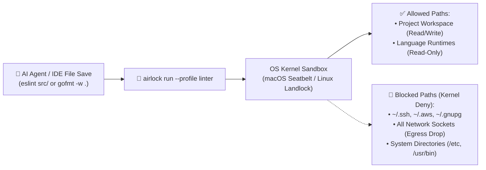

# Recipe: Fast Linter & Formatter Confinement (<15ms)

> **Use Case ID:** `AIR-UC-01`  
> **Target Audience:** Developers, AI Agent Operators, DevSecOps  
> **Platform Engine:** macOS Seatbelt (`sandbox-exec`) / Linux Landlock & `bwrap`  

---

## 1. Problem Statement

Formatters and linters (`gofmt`, `ruff`, `prettier`, `eslint`, `black`) run continuously on file save or after every autonomous agent code edit. While these tools are typically trusted, malicious plugins, compromised IDE extensions, or tampered configuration files (`.eslintrc.js`) can execute arbitrary code during linting and exfiltrate secrets over the local network. 

However, running linters inside heavy virtual machines introduces 100–300ms of lag per invocation, ruining developer flow and agent responsiveness.

---

## 2. When to Use This

Use the **Fast Linter Sandbox** whenever executing high-frequency code formatting or static analysis tools. Airlock provides:
- **Sub-15ms cold start latency** (zero virtualization overhead).
- **Read-only access to host system files** (blocking modifications to system libraries).
- **Zero network egress** (dropping all TCP/UDP connections at the kernel boundary).
- **Scoped write access** restricted exclusively to target project files.

---

## 3. Architecture & Dataflow



---

## 4. Prerequisites

1. **Airlock Installed:** `curl -fsSL https://raw.githubusercontent.com/bonjoski/airlock/main/install.sh | sh` (or `brew install bonjoski/tap/airlock`).
2. **Platform Support:** macOS 12+ (Apple Silicon / Intel) or Linux Kernel 5.13+ (with Landlock enabled).

---

## 5. Step-by-Step Recipe

### Step 1: Run a Linter Inside the Linter Profile
```bash
# Sandboxing JavaScript linter
airlock run --profile linter -- npx eslint src/

# Sandboxing Go formatter
airlock run --profile linter -- gofmt -w .

# Sandboxing Python linter
airlock run --profile linter -- ruff check .
```

### Step 2: Use in Pre-Commit Hooks
In your `.git/hooks/pre-commit`:
```bash
#!/usr/bin/env bash
airlock run --profile linter -- gofmt -l .
```

---

## 6. Verification & Expected Output

Verify that network egress is completely blocked during linting:
```bash
airlock run --profile linter -- curl -s https://example.com
```
Expected output:
```text
[airlock] Kernel boundary active (macOS Seatbelt)
curl: (7) Failed to connect to example.com: Operation not permitted
[airlock] Execution blocked by kernel network sandbox rule (EPERM).
```

Verify sub-15ms performance:
```bash
time airlock run --profile linter -- echo "ok"
```
Expected output:
```text
ok
real    0m0.012s
user    0m0.004s
sys     0m0.006s
```

---

## 7. Security Invariants & Blast Radius

- **Kernel-Level Enforcement:** Policy is enforced directly inside the Darwin / Linux kernel. Even if the linter process is exploited, it cannot open network sockets or read outside the allowed paths.
- **PTY Sanitization:** Terminal escape sequences (`TIOCSTI`) are neutralized to prevent subversion of the parent shell.
- **Fail-Closed:** If the kernel sandbox profile cannot be initialized, Airlock aborts execution immediately.

---

## 8. Troubleshooting & Common Pitfalls

- **Issue:** Linter fails because it requires reading global plugins in `~/.npm` or `~/.config`.  
  **Remediation:** Pass the `--allow-read-config` flag or add the config path to your workspace profile:
  ```bash
  airlock run --profile linter --read-path ~/.config/eslint -- npx eslint .
  ```
