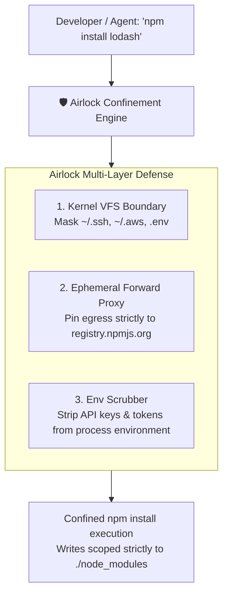

# Recipe: Sandboxing Package Managers (`npm`, `pip`, `cargo`)

> **Use Case ID:** `AIR-UC-02`  
> **Target Audience:** Developers, Autonomous Agents, CI/CD Pipeline Operators  
> **Platform Engine:** Ephemeral Proxy & VFS Sandboxing  

---

## 1. Problem Statement

Package managers (`npm install`, `pip install`, `cargo build`, `go get`) frequently execute arbitrary code during installation via lifecycle hooks (`postinstall.js`, `setup.py`, `build.rs`). Attackers exploit these hooks to steal developer SSH keys (`~/.ssh`), cloud tokens (`~/.aws/credentials`), or inject persistent backdoors into workstation system startup files (`~/.zshrc`, `~/Library/LaunchAgents`).

---

## 2. When to Use This

Use **Sandboxed Package Managers** whenever an AI agent or developer installs new dependencies or updates lockfiles. Airlock ensures:
- **Host Secret Masking:** `~/.ssh`, `~/.aws`, `~/.gnupg`, and `.env` files appear completely invisible/empty.
- **Strict Write Confinement:** Writes are allowed strictly to the target project's `node_modules/`, `target/`, or virtual environment.
- **Controlled Network Egress:** Outbound traffic is pinned strictly to canonical package registries (npm, PyPI, Crates.io) via an ephemeral local forward proxy; all untrusted IPs and DNS tunneling attempts are dropped.

---

## 3. Architecture & Dataflow



---

## 4. Prerequisites

1. **Airlock CLI:** Available on `$PATH`.
2. **Package Manager:** `node`/`npm`, `python`/`pip`, or `cargo` installed on host.

---

## 5. Step-by-Step Recipe

### Node.js / NPM Workflow
```bash
# Execute npm install inside the node sandbox
airlock run --profile node -- npm install

# Or for pnpm / yarn:
airlock run --profile node -- pnpm install
```

### Python / Pip Workflow
```bash
# Execute pip install inside the python sandbox
airlock run --profile python -- pip install -r requirements.txt
```

### Rust / Cargo Workflow
```bash
# Execute cargo build / cargo test with build.rs confinement
airlock run --profile cargo -- cargo build
```

---

## 6. Verification & Expected Output

Test that a malicious script attempting to read your SSH keys during `npm install` is blocked:
```bash
airlock run --profile node -- cat ~/.ssh/id_rsa
```
Expected output:
```text
[airlock] Kernel filesystem policy active.
cat: /Users/username/.ssh/id_rsa: Operation not permitted
[airlock] Kernel denial logged: Seatbelt blocked read attempt on ~/.ssh/id_rsa
```

Inspect output when running a clean install:
```bash
airlock run --profile node -- npm install express
```
Expected output:
```text
[airlock] Ephemeral proxy active on 127.0.0.1:58219 (Pinned: registry.npmjs.org)
[airlock] Scoped write boundary: /Users/username/code/my-app/node_modules

added 64 packages in 1.42s
[airlock] Command exited with code 0. Cache flushed.
```

---

## 7. Security Invariants & Blast Radius

- **Read-Only System Directories:** `/usr`, `/bin`, `/System`, `/etc`, and user home root are strictly read-only.
- **DNS Tunneling Neutralization:** The ephemeral forward proxy rejects anomalous non-registry UDP DNS tunnels and high-entropy domain lookups.
- **Output Secret Redaction:** In-stream pattern matching ensures that if a tool accidentally prints a sensitive token to stdout/stderr, it is redacted before reaching the agent's context window.

---

## 8. Troubleshooting & Common Pitfalls

- **Issue:** `npm install` fails with `EACCES: permission denied, mkdir '/root/.npm'` or similar cache error.  
  **Remediation:** Airlock isolates package caches to an ephemeral staging directory. Ensure `--cache-dir` is writable:
  ```bash
  airlock run --profile node --cache-dir /tmp/airlock-npm -- npm install
  ```
