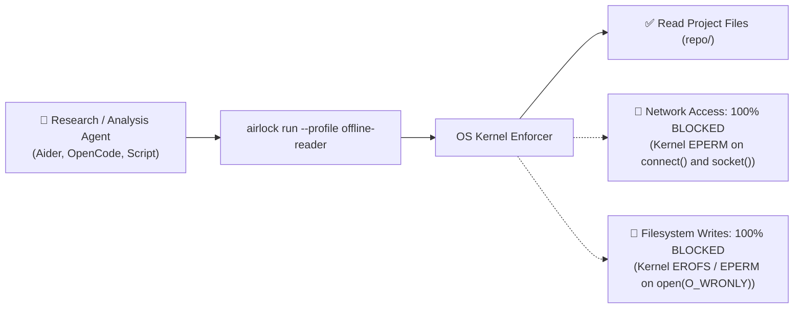

# Recipe: Strict No-Network Offline Code Exploration

> **Use Case ID:** `AIR-UC-04`  
> **Target Audience:** Codebase Researchers, LLM Evaluators, Privacy-Sensitive Teams  
> **Platform Engine:** Zero-Egress Kernel Drop (macOS Seatbelt / Linux Landlock)  

---

## 1. Problem Statement

When deploying autonomous AI agents to explore, summarize, or index proprietary source code repositories, organizations fear data leakage: What if a prompt injection embedded in an unreviewed source file instructs the model to curl sensitive customer data or proprietary algorithms to a remote IP address?

---

## 2. When to Use This

Use the **Offline Code Exploration Profile (`offline-reader`)** whenever an AI agent only needs to read repository files, compute embeddings, run search utilities (`ripgrep`, `grep`, `ast-grep`), or generate summaries. Airlock enforces:
- **Read-Only Filesystem:** Complete prohibition of file writes or deletions across the host and workspace.
- **Mathematically Dropped Network Sockets:** All outbound TCP, UDP, and ICMP sockets are blocked at the OS kernel VFS and network stack.
- **No IPC Leaks:** Blocks Mach ports (macOS) and abstract Unix domain sockets (Linux).

---

## 3. Architecture & Dataflow



---

## 4. Prerequisites

1. **Airlock:** Version 1.0+ on `$PATH`.
2. **Target Repository:** Clean local checkout.

---

## 5. Step-by-Step Recipe

### Step 1: Run Search or Code Exploration
```bash
# Search codebase with ripgrep with zero network egress
airlock run --profile offline-reader -- rg "TODO|FIXME" src/

# Run an analysis script on repository source code
airlock run --profile offline-reader -- python3 scripts/analyze_ast.py
```

### Step 2: Confine Autonomous Code Exploration Agents
```bash
# Confine Aider or custom research CLI to read-only exploration
airlock run --profile offline-reader -- aider --read-only
```

---

## 6. Verification & Expected Output

Verify that any attempt to write a file is immediately blocked by the kernel:
```bash
airlock run --profile offline-reader -- touch src/test.txt
```
Expected output:
```text
touch: src/test.txt: Read-only file system
[airlock] Kernel denial: Seatbelt blocked write on /Users/username/code/my-repo/src/test.txt
```

Verify that all network attempts fail immediately:
```bash
airlock run --profile offline-reader -- curl https://google.com
```
Expected output:
```text
curl: (7) Failed to connect to google.com: Operation not permitted
```

---

## 7. Security Invariants & Blast Radius

- **Unconditional Network Disconnect:** Even processes running as the local user cannot establish TCP/UDP handshakes.
- **Immutable Repository State:** Guarantees that agent exploration cannot introduce unreviewed code edits, delete branches, or overwrite history.

---

## 8. Troubleshooting & Common Pitfalls

- **Issue:** Script fails because it needs to write a temporary cache file.  
  **Remediation:** Provide an explicit in-memory scratch directory using `--scratch`:
  ```bash
  airlock run --profile offline-reader --scratch -- python3 script.py
  ```
