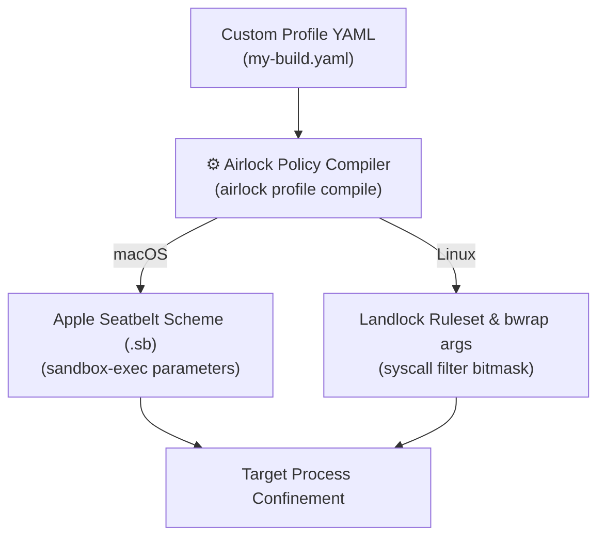

# Recipe: Custom Declarative Sandbox Profiles

> **Use Case ID:** `AIR-UC-05`  
> **Target Audience:** Systems Architects, DevSecOps Engineers, Platform Teams  
> **Platform Engine:** Declarative YAML & Policy Compiler  

---

## 1. Problem Statement

Standard development profiles (Node, Python, Go, Rust) cover 80% of common workloads, but enterprise teams frequently require custom boundary definitions:
- Allowing read-only access to proprietary SDK directories (`/opt/company/sdk`).
- Allowing outbound egress only to private corporate artifact registries (`artifactory.corp.internal:8443`).
- Permitting writes only to a specific output folder (`dist/`).

Authoring raw Apple Seatbelt Scheme (`.sb`) or Linux Landlock C structs by hand is error-prone and platform-dependent.

---

## 2. When to Use This

Use **Custom Declarative Sandbox Profiles** when you need fine-grained control over filesystem paths, network destinations, and environment variables across macOS and Linux using a single unified YAML specification.

---

## 3. Architecture & Dataflow



---

## 4. Prerequisites

1. **Airlock:** Version 1.0+ on `$PATH`.
2. **Text Editor:** To author or edit `.airlock/profiles/*.yaml`.

---

## 5. Step-by-Step Recipe

### Step 1: Create a New Profile Template
Generate a starter template:
```bash
airlock profile create corporate-build --template standard-dev
```
This generates `.airlock/profiles/corporate-build.yaml`.

### Step 2: Configure Declarative Rules
Edit `.airlock/profiles/corporate-build.yaml`:
```yaml
schema_version: "1.0"
name: "corporate-build"
description: "Confined build profile for corporate internal monorepo"

filesystem:
  read_only:
    - "/opt/company/sdk"
    - "{{.Workspace}}"
  read_write:
    - "{{.Workspace}}/dist"
    - "{{.Workspace}}/tmp"
  deny:
    - "~/.ssh"
    - "~/.aws"
    - "{{.Workspace}}/.env*"

network:
  mode: "allowlist"
  allowed_hosts:
    - "artifactory.internal.company.com:443"
    - "github.company.com:443"

environment:
  strip:
    - "*TOKEN*"
    - "*SECRET*"
    - "*PASSWORD*"
  inject:
    CI_BUILD_SANDBOX: "airlock"
```

### Step 3: Run With Your Custom Profile
```bash
airlock run --profile corporate-build -- make build
```

---

## 6. Verification & Expected Output

Validate profile compilation and syntax:
```bash
airlock profile validate corporate-build
```
Expected output:
```text
✅ Profile 'corporate-build' is valid.
   • Read-Only paths: 2 verified
   • Read-Write paths: 2 verified
   • Deny rules: 3 active
   • Network: Allowlist mode (2 hosts approved)
   • Compiled to native Seatbelt (macOS) & Landlock (Linux)
```

---

## 7. Security Invariants & Blast Radius

- **Cross-Platform Parity:** Airlock's policy compiler translates declarative YAML into exact kernel constraints on both Darwin and Linux, ensuring reproducible security boundaries across developer machines.
- **Fail-Closed on Unknown Primitives:** If an unsupported syscall or invalid CIDR range is declared, compilation fails closed before execution.

---

## 8. Troubleshooting & Common Pitfalls

- **Issue:** Custom path containing `{{.UserHome}}` fails to resolve.  
  **Remediation:** Use standard template variables `{{.UserHome}}` and `{{.Workspace}}` without surrounding quotes.
